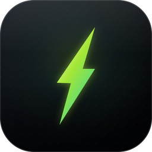

# ⚡ Spark Terminal



一个基于 **Electron + xterm.js + node-pty** 的轻量、年轻、可扩展终端窗口。
VSCode 同款终端内核，渲染走 canvas，大数据量输出不卡。

## ✨ 功能

- [x] 内嵌真实终端（自动探测 `pwsh` / `powershell` / `cmd`）
- [x] 键盘输入命令、实时显示输出
- [x] 多标签页（Ctrl+Shift+T 新建，Ctrl+Shift+W 关闭，Ctrl+Tab 切换）
- [x] 标签重命名：双击标题或 `F2` 内联编辑，右键可「恢复自动标题」，改名后锁定不被 shell 标题覆盖
- [x] 字体缩放：`Ctrl + =` / `Ctrl + -` / `Ctrl + 0`，或 **Ctrl + 鼠标滚轮**
- [x] 鼠标滚轮滚动、右侧拖动滚动条查看历史（scrollback 5000 行）
- [x] 拖文件进终端自动粘贴带引号的路径
- [x] 深色活力主题（青柠 + 电光紫渐变点缀）
- [x] 自定义无框窗口、底部状态栏（shell / 行列 / 缩放比例）

## 🧱 技术栈与架构

```
┌─────────────────────────────────────────────┐
│ Renderer (Chromium, sandboxed)               │
│  ┌─────────────── EventBus ──────────────┐  │
│  │  TerminalController  ←→  TabBar       │  │
│  │       │                    StatusBar   │  │
│  │       ▼                    TitleBar   │  │
│  │  TerminalSession (xterm.js + addons)  │  │
│  └───────────────┬───────────────────────┘  │
└──────────────────┼───────────────────────────┘
                   │ contextBridge (window.spark)
┌──────────────────┼───────────────────────────┐
│ Main (Node.js)   ▼                           │
│  ptyService.ts  ←  node-pty  ←  cmd/pwsh    │
└─────────────────────────────────────────────┘
```

**解耦要点**：
- UI 组件（TabBar/StatusBar/TitleBar）**不直接调用** Controller，全部通过 `core/EventBus` 订阅事件 → 换 UI 框架、加插件都不动核心。
- `TerminalSession` 把 xterm 实例和 pty 连接封装成黑盒，对外只有 `show/hide/focus/setZoom/dispose`。
- 主题是 CSS 变量 + `ThemeManager`，新增主题 = 新 CSS + 一条登记。
- preload 用 `contextBridge` 暴露最小 API，主进程永远拿不到渲染进程的 DOM。

## 📁 目录

```
terminal-app/
├── electron/                 # 主进程
│   ├── main.ts               # 入口、生命周期
│   ├── window.ts             # BrowserWindow 配置
│   ├── ptyService.ts          # node-pty 会话管理（IPC handler）
│   └── preload.ts             # contextBridge 安全桥
├── src/                      # 渲染进程
│   ├── main.ts                # 组装入口
│   ├── core/
│   │   ├── EventBus.ts        # 类型安全事件总线
│   │   └── ThemeManager.ts
│   ├── terminal/
│   │   ├── TerminalSession.ts # xterm + pty 单会话封装
│   │   └── TerminalController.ts # 多会话调度
│   ├── ui/
│   │   ├── TitleBar.ts
│   │   ├── TabBar.ts
│   │   └── StatusBar.ts
│   └── styles/
│       ├── base.css
│       └── theme-neon.css
└── electron.vite.config.ts
```

## 🚀 运行

```powershell
cd terminal-app
npm install        # node-pty 是原生模块，首次会本地编译；Windows 需要 VS Build Tools
npm run dev
```

打包：`npm run build`。

## ⌨️ 快捷键

| 快捷键 | 作用 |
|---|---|
| `Ctrl + =` / `Ctrl + -` / `Ctrl + 0` | 放大 / 缩小 / 复位字体 |
| `Ctrl + 滚轮` | 缩放字体 |
| `Ctrl + Shift + T` | 新建标签 |
| `Ctrl + Shift + W` | 关闭当前标签 |
| `Ctrl + Tab` / `Ctrl + Shift + Tab` | 切换标签 |
| `F2` | 重命名当前标签（也可双击标签标题） |
| `Ctrl + C` | 有选中则复制，无选中则发送 ETX 中断当前命令 |

> 注：刻意保留 `Ctrl+W` 给终端 readline（删除前一单词），未拦截。
> 底层 pty 在 Windows 上优先用 node-pty 自带的 `conpty.dll`（VS Code 同款），加载失败自动回退系统 ConPTY。

## 🔌 扩展点

1. **新主题**：在 `src/core/ThemeManager.ts` 的 `THEMES` 加一条，在 `src/styles/` 加个 css，UI 代码零改。
2. **新 shell（git bash / WSL / Cygwin）**：主进程 `electron/ptyService.ts` 的 `detectDefaultShell()` 加候选路径即可。
3. **新 addon**（选中即复制、分屏、查询、图片预览）：在 `TerminalSession` 构造函数里 `this.term.loadAddon(new XxxAddon())`。
4. **新 UI 面板**：订阅 `bus.on('session:created' | 'zoom:changed' | ...)`，无需改动 Controller。
